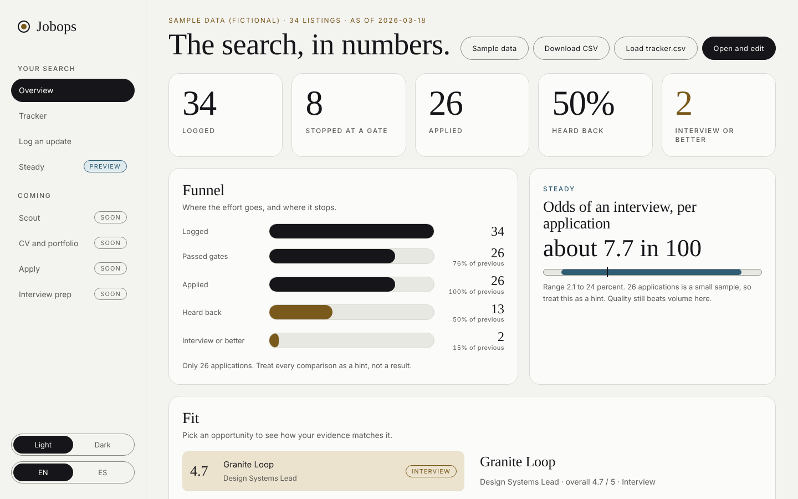

# Job Ops para Claude

Una forma tranquila y cuidadosa de llevar una búsqueda de trabajo remoto con Claude. **Todo es contexto, escrito en texto.** Tú controlas todo lo que sale de tus manos.

[English](README.md)

**Por qué existe.** Soy diseñador UX. Usé IA para buscar trabajo y los resultados fueron pobres: muchos rechazos, y algunas candidaturas preguntaban cómo uso la IA en mi trabajo. Veía repos con decenas de miles de estrellas, un estudio entero de agentes o un flujo de contenido en una caja, y quise añadir lo que sé de UX a algo así: una herramienta útil desde el primer día, no un ejemplo, y fácil para creativos sin base de IA. Esto es eso, hecho con Claude y usado en mi propia búsqueda. También es mi portfolio. [Lee la historia](https://joselblas.github.io/jobops-kit/story/es/).

En mi propia búsqueda hasta ahora (del 3 de agosto al 12 de noviembre de 2026): 148 ofertas registradas, 27 frenadas en un filtro antes de hacer ningún trabajo, 94 candidaturas, 50 rechazos (2 automáticos, uno después de una llamada de entrevista) y 1 llamada de entrevista. Son datos de una sola persona y la herramienta no arregló el mercado. Hizo la búsqueda más clara.

Creado por [Jose L. Blas](https://joselblas.com), diseñador de producto, durante una búsqueda real de roles remotos desde España. Sin framework, sin servidor, sin telemetría en el panel.

**[Configúralo en 15 minutos](https://joselblas.github.io/jobops-kit/setup/)** ([versión en texto](docs/setup.es.md)) · [Demo](https://joselblas.github.io/jobops-kit/app/) · [Diseño e historia](https://joselblas.github.io/jobops-kit/design/) · [Privacidad](docs/privacy.es.md)

## Todo es contexto

No escribes código ni configuras nada. Claude trabaja a partir de unos pocos archivos de texto: quién eres (`career-context.md`), qué quieres (`profile.yml`) y qué has hecho hasta ahora (`tracker.csv`). No los rellenas a mano. Escribe `Start` y Claude te entrevista, te enseña cada dato antes de guardarlo y escribe los tres archivos. Cambias un archivo, cambias lo que hace Claude. Así trabaja también un desarrollador de IA, y ahora así trabajas tú.

## Empieza en tres movimientos

1. **Añade las habilidades.** Descarga el repo y añade cinco habilidades de `skills/` a Claude (Ajustes, Habilidades).
2. **Escribe Start.** En un Proyecto de Claude, adjunta tu CV y escribe `Start`. Contesta unos 15 minutos de preguntas. Guarda los tres archivos que te da Claude en una carpeta privada.
3. **Abre el panel.** Abre `app/index.html` en Chrome o Edge y conecta esa carpeta.

Pasos completos, con lo que deberías ver en cada uno: [docs/setup.es.md](docs/setup.es.md).

## Privado por diseño, y claro sobre dónde está la línea

- **Solo en tu ordenador:** el panel, tu tracker y tu carpeta privada. El panel no hace peticiones de red, no tiene cuentas ni analítica. Cargamos nueve páginas y registramos las peticiones para comprobarlo.
- **En tu cuenta de Claude:** lo que escribas o subas al Proyecto lo procesa Claude según los ajustes de privacidad de tu cuenta. Tú decides qué entra, y `jobops-start` te pregunta al principio qué dejar fuera.
- **El asistente nunca** envía una candidatura, manda un mensaje, crea una cuenta ni se inventa un dato sobre ti.

Lee [docs/privacy.es.md](docs/privacy.es.md) (dos minutos).

## Dos partes, una búsqueda

| | El kit de Claude | El panel |
|---|---|---|
| Qué es | Cinco habilidades de Claude (o los mismos playbooks en markdown) que convierten un Proyecto de Claude o Claude Code en un asistente de búsqueda | Una página en tu navegador que muestra tu tracker y te da pequeñas herramientas |
| Dónde vive | `skills/`, `AGENTS.md`, `playbooks/`, `templates/`, `scripts/` | `app/` |
| Qué hace | Busca y filtra ofertas, comprueba los filtros, adapta CVs desde tus datos, rellena formularios y se detiene antes de enviar, lee tu exportación de correo para encontrar respuestas | Embudo y probabilidades, tracker, actualizaciones paso a paso, propuestas, borradores de seguimiento, revisión semanal |
| Necesita | Una cuenta de Claude con Proyectos | Un navegador. Chrome o Edge para guardar en tu archivo |

Comparten un archivo, `tracker.csv`. El asistente escribe propuestas. Tú las aceptas en el panel. Ninguno trabaja a tus espaldas.

## Elige tu camino

- **Quiero el asistente.** Sigue [docs/setup.es.md](docs/setup.es.md), pasos 1 a 8. Instala cinco habilidades, crea un Proyecto y escribe `Start`. Sin código.
- **Uso Claude Code.** La misma guía, "Otras formas de usarlo".
- **Solo quiero el panel.** Abre la [demo](https://joselblas.github.io/jobops-kit/app/) o abre `app/index.html` en Chrome o Edge y pulsa **Connect folder** (columnas en `app/README.md`).

## Principios

- **Primero los filtros, luego la puntuación.** Modo remoto, geografía, idioma, permiso de trabajo y legitimidad se comprueban en la página de la propia empresa, con prueba citada, antes de tocar ningún CV.
- **Solo hechos.** Cada CV y cada respuesta sale de un archivo, `career-context.md`. Un script marca los números, fechas y nombres que no contiene.
- **Funciona desde fuera de EE. UU.** Las listas de países y la ubicación de la entidad se verifican, no se suponen por la palabra "remote".
- **Honesto con los huecos.** Los huecos de encaje se dicen, no se suavizan.
- **El botón lo pulsas tú.** El asistente no envía, no manda mensajes, no crea cuentas y no escribe contraseñas. No se inventa nada sobre ti.

## Las habilidades

| Habilidad | Qué cubre |
|---|---|
| `jobops-start` | Entrevista inicial que escribe tus tres archivos de partida |
| `jobops-screen` | Explorar, filtros, comprobación de legitimidad, puntuación de encaje |
| `jobops-craft` | Auditar el CV maestro y el portfolio, y ajustarlos a cada oferta |
| `jobops-apply` | Adaptar el CV, comprobar los datos, rellenar el formulario y parar antes de enviar |
| `jobops-review` | Revisión del embudo, barrido de correo, valoraciones de encaje, banco de historias para entrevistas |

Tres habilidades más recientes, `jobops-vault` (la entrevista de excavación), `jobops-hooks` (ganchos, posicionamiento, formatos de portfolio) y `jobops-cv` (CV construido con datos graduados), están en `skills/` y todavía se están probando.

Los playbooks siguen siendo la referencia completa y el camino para Claude Code. Para comprobar que las habilidades se portan bien, ejecuta la prueba de [docs/testing-skills.md](docs/testing-skills.md).

## Qué hay en el panel

Tarjetas redondeadas, menú a la izquierda, tema claro por defecto con opción oscura, inglés y español. Lee tu propio `tracker.csv` y no envía nada a ningún sitio.

- **Overview**: embudo, probabilidad de entrevista en palabras claras, radar de encaje, puntuación frente a resultado, lista de espera.
- **Tracker**: filtra, busca, ordena y edita. En Chrome o Edge guarda directamente en tu archivo.
- **Log an update**: una pregunta por paso. Llegó una respuesta, envié una candidatura, hubo una entrevista.
- **Follow-ups**: candidaturas en silencio durante tres semanas, cada una con un borrador corto. Lo copias y lo envías tú. La app no envía nada.
- **Proposed updates**: el asistente lee tu exportación de correo y propone cambios con una cita como prueba. Aceptas u omites cada uno.
- **CV and portfolio**: etiqueta cada candidatura con la versión de CV y el enfoque de portfolio usados y mira cuál recibe respuestas, con la advertencia de muestra pequeña.
- **Weekly review**: cinco minutos tranquilos. La semana frente a la anterior, cerrar candidaturas muertas, una cosa que hiciste bien, un foco para la semana siguiente.
- **Proof**: lista de seis puntos de lo que un reclutador puede encontrar sobre ti, tu archivo de datos de carrera por grado de evidencia y tu registro de ganchos. Todo se queda en el navegador.
- **Steady** (vista previa): tu propia tasa base y una línea con humor seco tras un rechazo, con un borrador de petición de feedback que copias y envías tú.

## Límites

- `cv_factcheck.py` detecta números, fechas y nombres sin respaldo. No detecta una reformulación que cambie el sentido. Lee cada CV.
- `liveness.py` usa APIs públicas de Greenhouse, Lever y Ashby. Otros sistemas suelen necesitar comprobación en navegador.
- La automatización de formularios es frágil. Verifica los valores desde la página, no desde capturas.
- El barrido de correo busca frases. Se le escapan respuestas. Úsalo como ayuda, no como juez.
- Las muestras pequeñas engañan. Tus probabilidades en el panel llevan un rango por eso.
- Ninguna herramienta arregla un portfolio débil ni un mal encaje. Esta evita que gastes esfuerzo en las ofertas equivocadas.

## Créditos y licencia

Inspirado en el proyecto de código abierto [career-ops](https://github.com/career-ops-hq/career-ops), que sigue un enfoque parecido de markdown y línea de comandos, con un escáner mayor y un flujo de PDF. Este kit es un trabajo más pequeño e independiente con otro foco: filtros primero, comprobación geográfica para quien no vive en EE. UU. y verificación de datos del CV.

Licencia MIT. Mira `LICENSE`.
