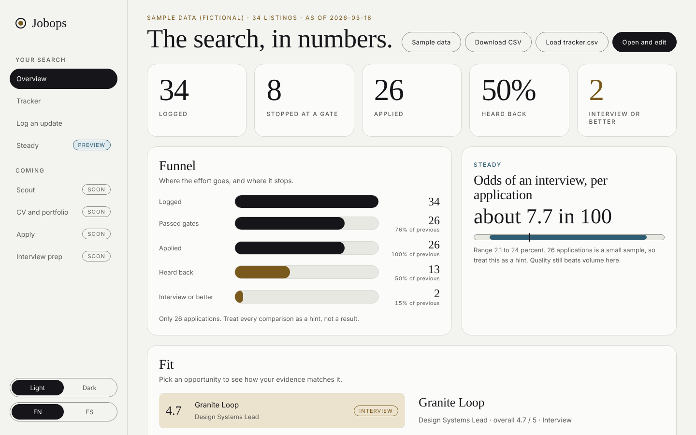
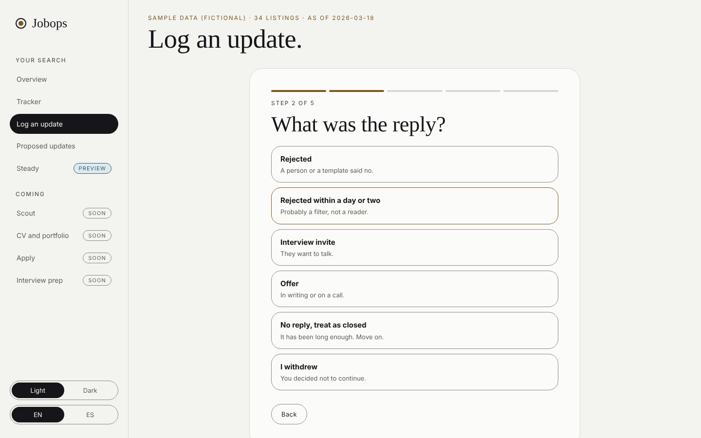
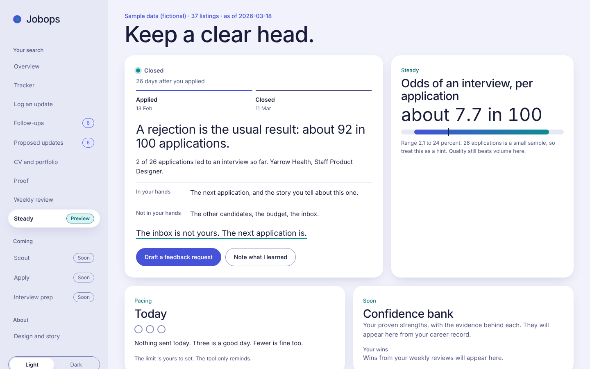
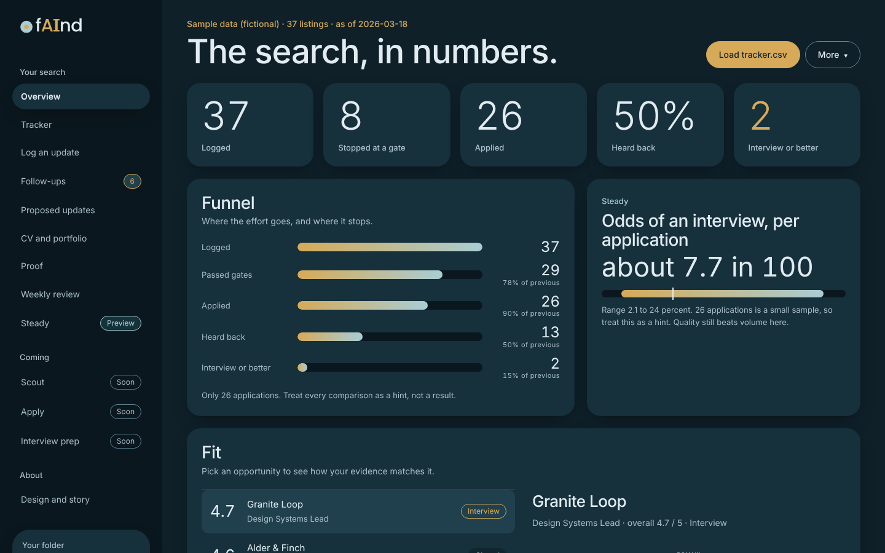

# Job Ops for Claude

A calm, careful way to run a remote job search with Claude. **Everything is context, written as text.** You stay in control of everything that leaves your hands.

[Español](README.es.md)

**Why this exists.** I am a UX designer. I used AI to look for work and the results were poor: lots of rejections, and some applications asked how I use AI in my job. I kept seeing repos with tens of thousands of stars, a full studio of agents or a content workflow in a box, and wanted to add what I know as a UX designer to something like that: a tool that is useful from day one, not an example, and easy for creatives with no AI background. This is that, built with Claude and used on my own search. It is also my portfolio. [Read the story](https://joselblas.github.io/jobops-kit/story/) ([en español](https://joselblas.github.io/jobops-kit/story/es/)).

In my own search so far (3 August to 12 November 2026): 148 listings logged, 27 stopped at a gate before any work, 94 applications, 50 rejections (2 automatic, one after an interview call), 1 interview call. It is one person's data, and the tool did not fix the market. It made the search clearer.

Built by [Jose L. Blas](https://joselblas.com), a product designer, during a real search for remote roles from Spain. No framework, no server, no telemetry in the dashboard.

**[Set it up in 15 minutes](https://joselblas.github.io/jobops-kit/setup/)** ([text version](docs/setup.md)) · [Live demo](https://joselblas.github.io/jobops-kit/app/) · [Design and story](https://joselblas.github.io/jobops-kit/design/) · [Design system](docs/design-system.md) · [Privacy](docs/privacy.md)



## Everything is context

You do not write code and you do not configure anything. Claude works from a few plain text files: who you are (`career-context.md`), what you want (`profile.yml`) and what you have done so far (`tracker.csv`). You do not fill them in by hand. Say `Start` and Claude interviews you, shows you each fact before keeping it, and writes the three files. Change a file, change what Claude does. That is how an AI developer works too, and now it is how you work.

## Start in three moves

1. **Add the skills.** Download the repo and add five skills from `skills/` to Claude (Settings, Skills).
2. **Say Start.** In a Claude Project, attach your CV and type `Start`. Answer about 15 minutes of questions. Save the three files Claude gives you in a private folder.
3. **Open the dashboard.** Open `app/index.html` in Chrome or Edge and connect that folder.

Full steps with what you should see at each one: [docs/setup.md](docs/setup.md).

## Private by design, honest about where the line is

- **On your computer only:** the dashboard, your tracker and your private folder. The dashboard makes no network requests, has no accounts and no analytics. We loaded nine pages and recorded the requests to check.
- **In your Claude account:** what you type or upload to the Project is processed by Claude under your account's privacy settings. You decide what goes in, and `jobops-start` asks you at the start what to keep out.
- **The assistant never** submits, sends a message, creates an account or invents a fact about you.

Read [docs/privacy.md](docs/privacy.md) (two minutes).

## Two parts, one search

| | The Claude kit | The dashboard |
|---|---|---|
| What it is | Five Claude skills (or the same playbooks as plain markdown) that turn a Claude Project or Claude Code into a job-search assistant | A page in your browser that shows your tracker and gives you small tools |
| Where it lives | `skills/`, `AGENTS.md`, `playbooks/`, `templates/`, `scripts/` | `app/` |
| What it does | Finds and screens listings, checks the gates, tailors CVs from your facts, fills forms and stops before Submit, reads your email export for replies | Funnel and odds, tracker, step-by-step updates, proposed updates, follow-up drafts, weekly review |
| Needs | A Claude account with Projects | A browser. Chrome or Edge to save to your file |

They share one file, `tracker.csv`. The assistant writes proposals. You accept them in the dashboard. Neither works behind your back.

## Pick your path

- **I want the assistant.** Follow [docs/setup.md](docs/setup.md), steps 1 to 8. Install five skills, make a Claude Project, say `Start`. No code.
- **I use Claude Code.** Same guide, "Other ways to run it".
- **I only want the dashboard.** Open the [demo](https://joselblas.github.io/jobops-kit/app/), or open `app/index.html` in Chrome or Edge and press **Connect folder** (columns in `app/README.md`).

## Principles

- **Gates before scores.** Remote mode, geography, language, work authorization and legitimacy are checked on the employer's own posting, with quoted evidence, before any CV work.
- **Facts only.** Every CV and answer comes from one file, `career-context.md`. A script flags numbers, dates and names it does not contain.
- **Works from outside the US.** Country lists and entity locations are verified, not assumed from the word "remote".
- **Honest about gaps.** Gaps in fit are stated, not softened.
- **You press the button.** The assistant will not submit, send messages, create accounts or enter passwords. It will not invent anything about you.

## The skills

| Skill | Covers |
|---|---|
| `jobops-start` | First-run interview that writes your three starter files |
| `jobops-screen` | Scout, gates, legitimacy check, fit score |
| `jobops-craft` | Audit the master CV and portfolio, tune them for each listing |
| `jobops-apply` | Tailor the CV, fact check, fill the form, stop before Submit |
| `jobops-review` | Funnel review, email sweep, fit ratings, interview story bank |

Three newer skills, `jobops-vault` (the excavation interview), `jobops-hooks` (hooks, positioning, portfolio formats) and `jobops-cv` (CV built from graded facts), are in `skills/` and are still being tested. Their playbooks are `vault.md`, `hooks.md`, `portfolio-formats.md` and `cv-builder.md`.

They are condensed copies of the playbooks and work without the scripts. The playbooks stay the full reference and the path for Claude Code. To check the skills behave, run the test in [docs/testing-skills.md](docs/testing-skills.md). Fit ratings use the anchors in [docs/score-anchors.md](docs/score-anchors.md).

## How it flows

```
scout -> gates -> fit score -> you pick -> tailor CV -> fact check
      -> you review -> apply (stops before Submit) -> you submit
      -> tracker -> follow up -> funnel review -> interview story bank
```

| Stage | Playbook | Script |
|---|---|---|
| Find and screen listings | `playbooks/scout.md` | |
| Gates and fit score | `playbooks/score-rubric.md` | |
| Open? Real? | `playbooks/liveness-and-legitimacy.md` | `scripts/liveness.py` |
| Build and tune the CV and portfolio | `playbooks/craft.md` | |
| Tailor CV | `playbooks/cv-tailor.md` | `scripts/cv_factcheck.py` |
| Fill forms | `playbooks/apply.md` | |
| Rate fit for unrated listings | `playbooks/fit-helper.md` | |
| Find replies in your email | `playbooks/inbox-sweep.md` | `scripts/email_sweep.py` |
| Learn what works | `playbooks/funnel-analytics.md` | `scripts/funnel.py` |
| Interview prep | `playbooks/interview-story-bank.md` | |

Scripts need Python 3 and nothing else. Check a CV: `python3 scripts/cv_factcheck.py --facts career-context.md --cv cv/CV-Company-2026-01-01.docx`.

## What is in the dashboard

Rounded cards, a left menu, light by default with a dark option, English and Spanish. It reads your own `tracker.csv` and sends nothing anywhere.

- **Overview**: funnel, odds of an interview in plain words, fit radar, score against outcome, waiting list.
- **Tracker**: filter, search, sort and edit. In Chrome or Edge it saves straight back to your file.
- **Log an update**: one question per step. A reply arrived, I applied, an interview happened.
- **Follow-ups**: applications silent for three weeks, each with a short draft in English or Spanish. You copy it and send it yourself. Nothing is sent from the app.
- **Proposed updates**: the assistant reads your email export and proposes changes with a quote as evidence. You accept or skip each one. It can also propose fit ratings for unrated listings.
- **CV and portfolio**: tag each application with the CV version and portfolio lead you used and see which gets replies, with the small-sample caveat. Also copy-ready prompts for the `jobops-craft` skill.
- **Weekly review**: five calm minutes. The week against the one before, a chance to close dead applications, one thing you did well, a focus for next week.
- **Proof**: a six-point checklist of what a recruiter can find about you, plus your career vault (how many facts are measured, remembered, estimated or open, and which high-relevance ones to firm up first) and your hook ledger with plain-language checks. Load `career-vault.md` and `hooks.csv` from your private folder. Nothing leaves the browser.
- **Steady** (preview): your own base rate and one dry line after a rejection. After a rejection it shows a dated trail and offers a short, polite feedback request you copy and send yourself.
- **Scout, Apply, Interview prep**: menu pages marked Soon.

| Log an update | Steady | Dark |
|---|---|---|
|  |  |  |

## Limits

- `cv_factcheck.py` catches unsupported numbers, dates and names. It does not catch rewording that changes meaning. Read every CV.
- `liveness.py` uses public APIs for Greenhouse, Lever and Ashby. Other systems often need a browser check.
- Form automation is fragile. Verify field values from the page, not from screenshots.
- The email sweep matches phrases. It misses some replies. Treat it as a helper, not a judge.
- Small samples mislead. Your odds in the dashboard come with a range for that reason.
- No tool fixes a weak portfolio or a poor fit. This one stops you wasting effort on the wrong listings.

## Privacy

The full picture is in [docs/privacy.md](docs/privacy.md). In short: your files stay in a folder outside this repo and are gitignored, and `python3 scripts/privacy_check.py` flags leaks before you publish a fork. See `docs/lessons-learned.md`.

## Credits and license

Inspired by the open-source [career-ops](https://github.com/career-ops-hq/career-ops) project, which takes a similar markdown-and-CLI approach with a larger scanner and PDF pipeline. This kit is a smaller, independent work with a different focus: gate-first screening, geography checks for non-US applicants, and a fact check on CVs.

MIT license. See `LICENSE`.
