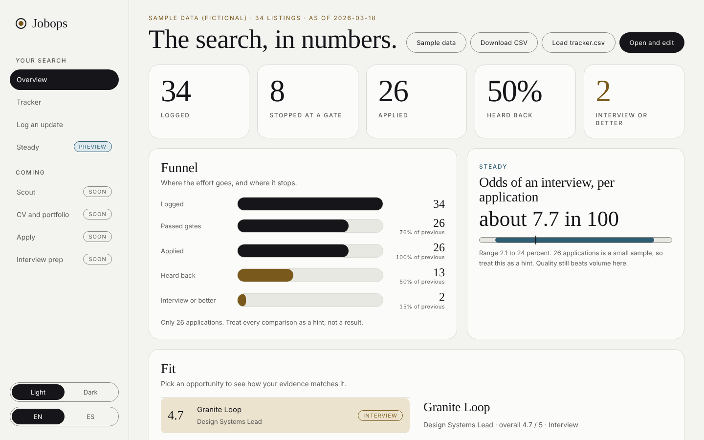
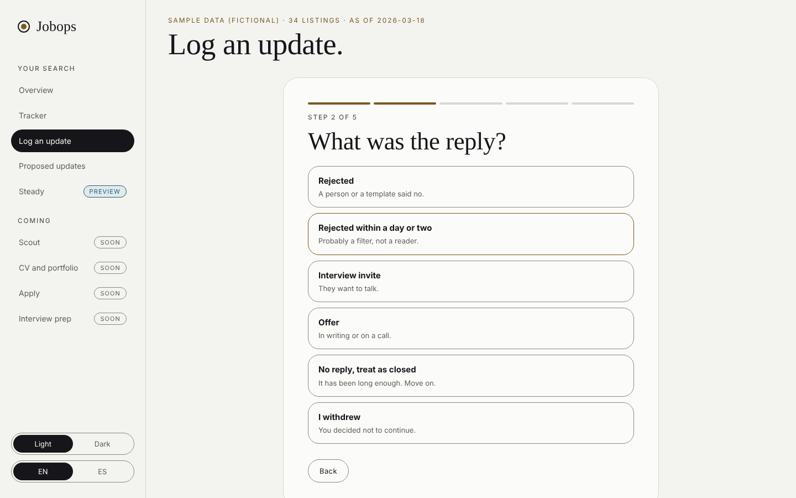
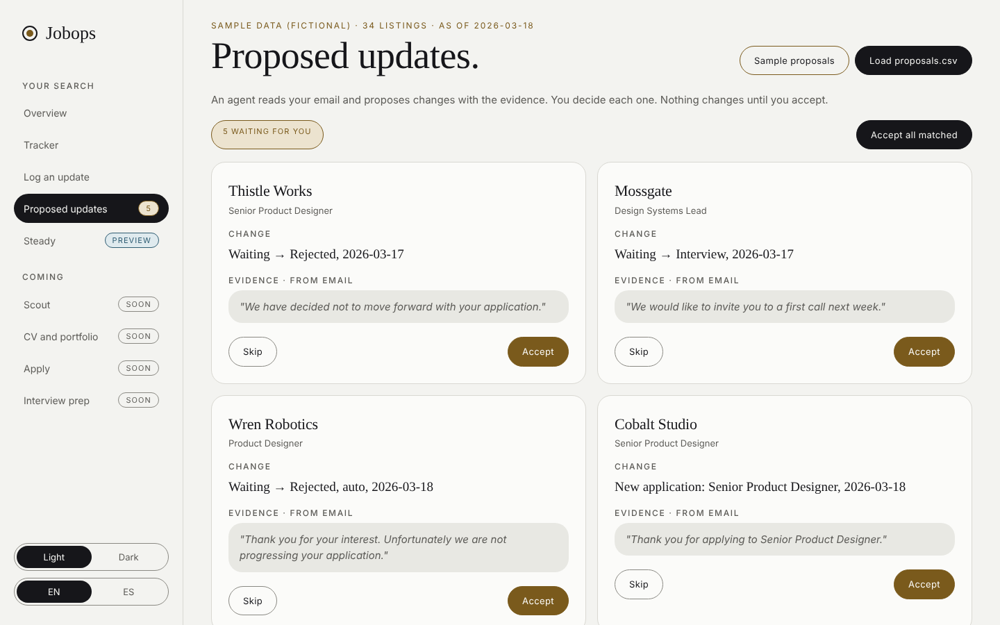
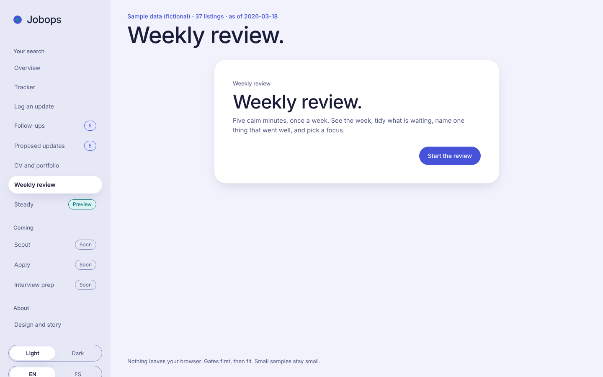
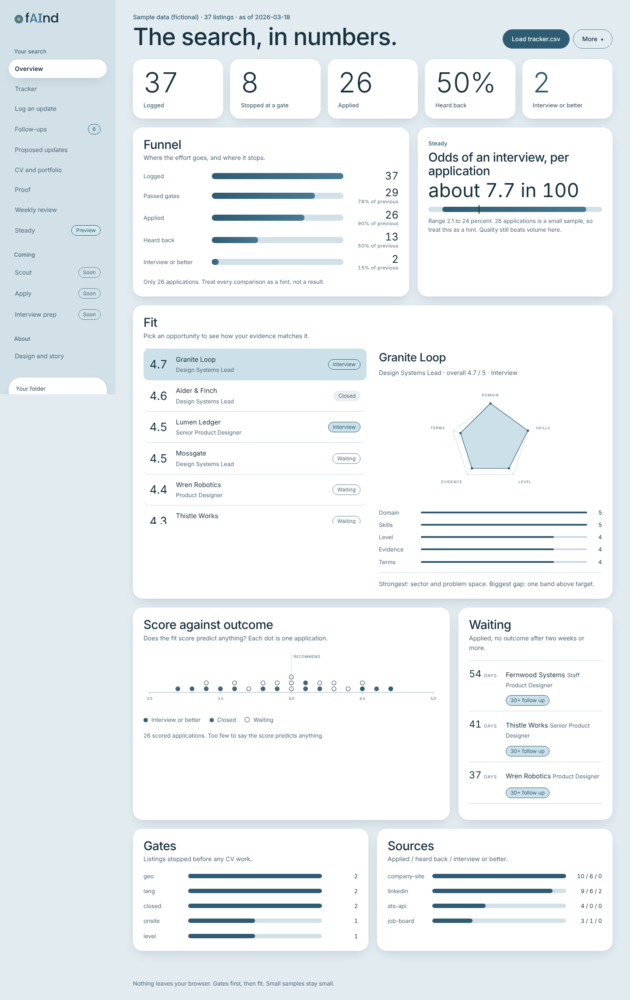

# Dashboard

A full-screen, no-dependency dashboard for `tracker.csv`. Rounded cards, a left menu, light by default with a dark option, English and Spanish. Everything runs in your browser. Nothing is uploaded.

## Use

1. Open `index.html` in a browser (double click works, no server needed), or use the live demo.
2. Press **Open and edit** (Chrome or Edge) to edit your file in place, or **Load tracker.csv** or drop the file on the page.
3. First load shows fictional sample data (`sample-tracker.csv`).

## Menu

| Page | State | What it does |
|---|---|---|
| Overview | Live | Key numbers, funnel, odds of an interview, fit radar, score against outcome, waiting list, gates, sources |
| Tracker | Live | Filter, search, sort and edit every listing, or add one |
| Log an update | Live | One question per step: a reply arrived, I applied, an interview happened |
| CV and portfolio | Live | Tag applications with `cv_version` and `portfolio_lead` in the tracker editor. The page groups them and shows reply rate with a range, leaves out applications under 21 days old with no reply, and says when there are too few to compare. It also gives copy-ready prompts for the jobops-craft skill: audit the CV, audit the portfolio, tune for a listing |
| Follow-ups | Live | Applications silent for 21 days or more. Each has an editable draft in English or Spanish, a check-in or close-the-loop tone, and your name and portfolio link (kept in this browser only). Copy it and send it yourself. Mark as sent adds a dated note to the row, or close it as no reply |
| Proposed updates | Live | Load a `proposals.csv` from an email sweep. Each change shows the evidence. Accept or skip, one by one or all matched at once |
| Weekly review | Live | Four steps: the week in numbers, what is still waiting (close old ones as no reply), one thing that went well, next week's focus. Wins show in Steady, stored in this browser only |
| Proof | Live | A six-point checklist, your career vault by evidence grade with the high-relevance facts to firm up first, and your hook ledger with checks (placed on an unconfirmed fact, strength under 4, no story, fact missing or graded differently in the vault, too many plants). Load `career-vault.md` and `hooks.csv`. Your ticks are kept in this browser only |
| Steady | Preview | Your own odds in plain words, a pacing guard, a dated trail and one dry line after a rejection, and a feedback request draft you copy and send yourself |
| Scout, Apply, Interview prep | Coming | Placeholder pages showing what each will do and in which roadmap phase |

## Log an update

One question at a time, big choices that move on when you pick them, Enter to continue, a progress bar and a review step before saving. Pick **A reply arrived** and choose the application, then the kind of reply (rejected, rejected within a day or two, interview invite, offer, no reply, withdrew), the date and an optional note. After a rejection you get a Steady card with your own base rate and one line to carry.

## Saving

In Chrome or Edge, **Open and edit** writes changes straight back to your file. In other browsers use **Download CSV**. The page warns you before closing with unsaved changes.

## Columns

The base columns are the same as `templates/tracker.example.csv`. Outcome values: `rejected`, `rejected-auto`, `interview`, `offer`, `withdrawn`, `no-response`. For the fit profile, add five optional columns with values from 1 to 5, matching `playbooks/score-rubric.md`:

`domain, skill, level, evidence, terms`

Rows without them still work. `scripts/funnel.py` ignores the extra columns.

## Language and theme

Use the switches at the bottom of the menu. Your choice is remembered in this browser only.

## Privacy

Your real tracker stays local and gitignored. The sample data is invented. The page makes no network requests and uses system fonts.

## Proposed updates

Columns: `kind` (`outcome`, `applied` or `fit`), `company`, `role`, `outcome`, `date`, `evidence`, `source`. See `templates/proposals.example.csv` and `playbooks/inbox-sweep.md`. Proposals that match no tracker row cannot be accepted, so nothing is created by accident.

## Weekly review

### Fit proposals

A `fit` row proposes the five ratings (`domain`, `skill`, `level`, `evidence`, `terms`, each 1 to 5) with a `reason`. In a fit row the `evidence` column is the rating, not a quote. Accepting writes the ratings, and sets the overall score to the average rounded to a half point if the row has none. See `playbooks/fit-helper.md` and `templates/fit-proposals.example.csv`.

